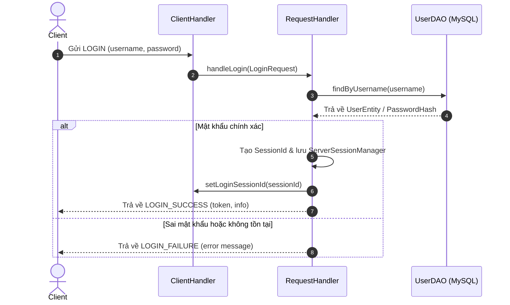
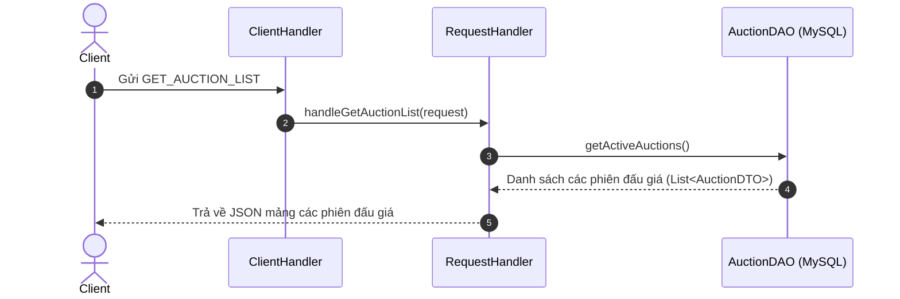
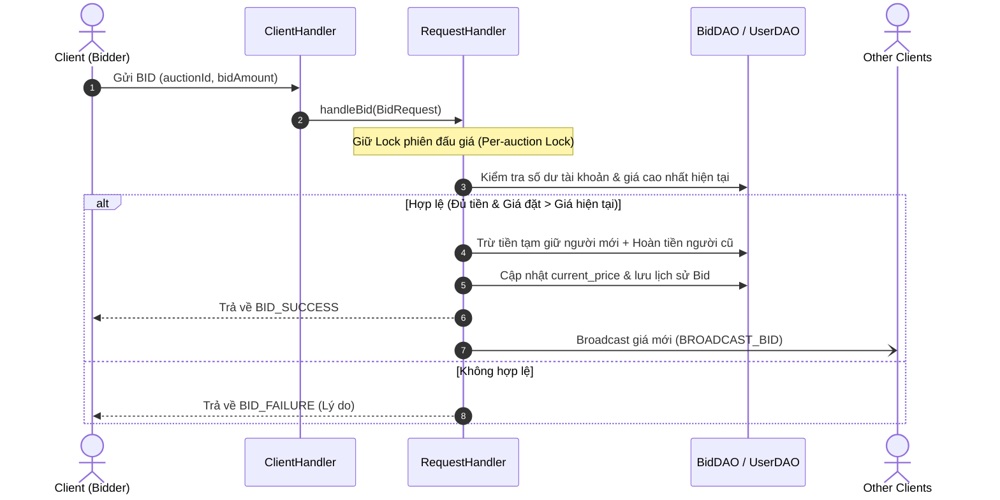
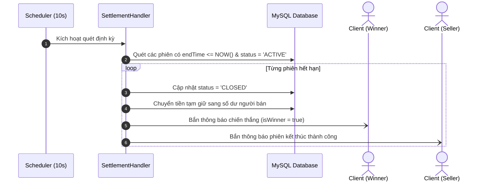

# Báo cáo Thiết kế Kiến trúc & Sơ đồ Tuần tự (Tuần 1 - TV2)

## 1. Biểu đồ tuần tự (Sequence Diagrams)

### 1.1 Luồng Đăng nhập (Login)

### 1.2 Luồng Lấy danh sách đấu giá (Get Auction List)

### 1.3 Luồng Đặt giá (Place Bid)

### 1.4 Luồng Kết thúc phiên (Settlement)

## 2. Chốt transaction boundary và per-auction lock hoặc optimistic locking; ghi ADR.
    
### 2.1 Bối cảnh (Context)
Trong hệ thống đấu giá trực tuyến, thao tác đặt giá (Place Bid) có thể xảy ra đồng thời từ nhiều người dùng khác nhau cho cùng một phiên đấu giá. Nếu không có cơ chế kiểm soát, hệ thống sẽ gặp các vấn đề nghiêm trọng:
- **Race Condition:** Hai người dùng cùng đọc giá hiện tại là $100k$ và cùng đặt thành công $110k$.
- **Bất toàn vẹn dữ liệu (Data Inconsistency):** Trừ tiền người đặt mới nhưng lỗi mạng không hoàn lại tiền cọc cho người giữ giá cũ, hoặc số dư ví bị cập nhật sai lệch.

### 2.2 Quyết định kỹ thuật (Decision)
1. **Transaction Boundary (Ranh giới giao dịch CSDL):**
    - Mọi thao tác nghiệp vụ của một lần đặt giá (kiểm tra số dư $\rightarrow$ trừ tiền cọc bidder mới $\rightarrow$ hoàn tiền cọc bidder trước $\rightarrow$ cập nhật `current_price` $\rightarrow$ ghi bảng log `bids`) phải được gói gọn trong **1 Database Transaction duy nhất**.
    - Thiết lập `connection.setAutoCommit(false)` ở đầu xử lý; chỉ `commit()` khi toàn bộ các bước thành công; nếu có bất kỳ ngoại lệ nào phát sinh lập tức `rollback()` để bảo toàn số dư.

2. **Cơ chế khóa đồng thời (Per-auction Lock):**
    - Áp dụng cơ chế khóa phân đoạn theo phiên đấu giá bằng cách sử dụng `ConcurrentHashMap<Integer, ReentrantLock>` ánh xạ theo `auctionId` tại tầng bộ nhớ Server.
    - Khi có request `BID` gửi tới phiên $X$, chỉ luồng xử lý phiên $X$ bị giữ khóa; các phiên đấu giá khác ($Y, Z$) vẫn tiếp nhận và xử lý đặt giá bình thường mà không bị ảnh hưởng.
    - Sử dụng khối `try-finally` để đảm bảo `lock.unlock()` luôn được giải phóng an toàn kể cả khi có lỗi logic xảy ra.

### 2.3 Hệ quả (Consequences)
- **Ưu điểm:**
    - Đảm bảo tính nguyên tử (ACID) tuyệt đối cho luồng tiền tệ và thứ tự trả giá.
    - Hiệu năng hệ thống tối ưu hơn rất nhiều so với việc dùng `synchronized` đồng bộ hóa toàn bộ phương thức (gây nghẽn toàn bộ server).
- **Nhược điểm & Biện pháp khắc phục:**
    - Map chứa khóa trong bộ nhớ RAM cần được dọn dẹp (evict) khi phiên đấu giá kết thúc để tránh rò rỉ bộ nhớ (Memory Leak).